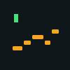

#  hum2midi

Convert hummed or monophonic audio recordings to quantized MIDI. Requires `ffmpeg` (all platforms).

    hum2midi ~/Downloads/*.m4a
    hum2midi -b 100 -f -o ~/Desktop/Songs idea.m4a
    hum2midi -q recording.wav   # enable quantization

Options: `-o` output folder (default: a `midi` folder next to each input), `-b` fixed tempo, `-f` fold stray octave jumps, `-q/--quantize` enable quantization (default: off), `-j` workers.

Install with Homebrew:

    brew install starzonmyarmz/tap/hum2midi

Or from source: `python3 -m venv venv && venv/bin/pip install -e . && ln -s "$PWD/venv/bin/hum2midi" ~/.local/bin/hum2midi`

## Develop

    python3 -m venv .venv && .venv/bin/pip install -e . pytest
    .venv/bin/pytest
    uvx ruff check . && uvx ruff format --check .

## Releases

`scripts/release` works out the next version from the Conventional Commits since the last tag (`feat` is minor, `fix` or `perf` is patch, a breaking change is major), writes it to `pyproject.toml`, turns `[Unreleased]` in `CHANGELOG.md` into that version's section, commits, tags `vX.Y.Z` and pushes. Pass `--dry-run` to only look, or a version to override.

The tag runs `.github/workflows/release.yml`, which checks the tag against `pyproject.toml` and publishes a GitHub release with the changelog section as notes, and `itch.yml`, which pushes a source zip to itch.io (it needs the `BUTLER_API_KEY` secret). [starzonmyarmz/homebrew-tap](https://github.com/starzonmyarmz/homebrew-tap) then renders `packaging/homebrew/hum2midi.rb` from the release.
